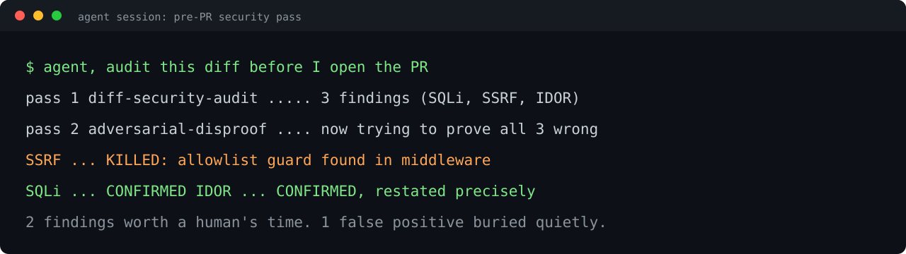

# secure-coding-skills

[](https://github.com/Epsilon0xCell/secure-coding-skills/releases) [](LICENSE) [](https://github.com/Epsilon0xCell/secure-coding-skills/stargazers)



**Your coding agent wrote the diff. These skills make it tear its own findings apart before the PR.**

Coding agents write vulnerable code at the same speed they write everything else. The usual response is a security review after the fact, by a tired human, on a deadline. This pack moves the review inside the agent's own workflow and gives it two jobs that are usually done badly when they are combined: find the defects, then try honestly to prove each defect does not exist.

## Install

```sh
git clone https://github.com/Epsilon0xCell/secure-coding-skills.git
cd secure-coding-skills
./install.sh
```

That copies both skills into `~/.claude/skills`. Set `SKILLS_DIR` to install somewhere else. The skills are plain markdown in the SKILL.md format, so any agent that reads skill files can use them; nothing here is tied to one vendor.

Then, before a pull request:

> Run diff-security-audit on my changes against main. Then run adversarial-disproof on whatever it finds. Show me only what survives.

## Contents

- [Install](#install)
- [What is in the pack](#what-is-in-the-pack)
- [Why two passes](#why-two-passes)
- [Honest limits](#honest-limits)
- [Contributing](#contributing)
- [License](#license)

## What is in the pack

| Skill | Job |
|---|---|
| `diff-security-audit` | Reads the whole diff, maps the changed attack surface, and audits five classes: injection, SSRF, authorization, secrets, and unsafe deserialization. Every finding carries a traced data flow and its preconditions, or it does not ship. |
| `adversarial-disproof` | Takes the findings and attacks them: hunts for the guard the first pass missed, retraces each flow from the sink backwards, breaks the stated preconditions, and writes the strongest honest argument for closing each finding as invalid. Findings leave as confirmed, downgraded, killed, or unexamined, with reasons. |

The audit skill ships with a reference file per class: the patterns to look for, the two questions that decide most cases, and the false-positive traps that waste maintainers' time.

## Why two passes

A first-pass audit, human or agent, has a known failure shape: it reads the diff, pattern-matches a dangerous sink, and reports it with high confidence, without reading the middleware, the data layer, or the framework defaults that decide whether the sink is actually exposed. The finding sounds right. It is often wrong, and every wrong finding taxes the next right one.

So the second skill exists only to disprove. Its worked example set in this repo shows the whole range: a SQL injection that survives because the guard the auditor hoped for is not there, an SSRF that gets killed because the guard was sitting in middleware the first pass never opened, and an IDOR that comes out confirmed and more precisely stated than it went in. Read those three folders in `examples/` and you understand the pack better than any description here can manage.

## Honest limits

- These are review skills, not a scanner and not a proof. They make an agent's self-review disciplined and its false positives rarer. They do not make code safe by inspection alone, and a finding marked unexamined is exactly that.
- The audit is diff-scoped on purpose. It will miss pre-existing defects the diff does not touch or make reachable; it says so in its own close-out rather than pretending otherwise.
- The five classes are the ones that dominate real-world PR defects. They are not the whole of application security, and the pack says that too.

## Contributing

New class references and new worked examples are the contributions that matter. A worked example needs all three parts: the code, the finding, and the disproof attempt, and the disproof has to be a genuine attempt, not a ceremony. See CONTRIBUTING.md.

## License

MIT. Written by Gavin Blacklock ([Epsilon0xCell](https://github.com/Epsilon0xCell)). Offensive counterpart: the AI red-teaming skills pack lives with my other security work on the same profile, next to [userspace-vpn-client](https://github.com/Epsilon0xCell/userspace-vpn-client).
